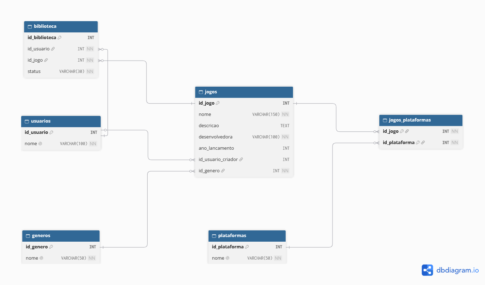

# Biblioteca de Jogos — TCA

Sistema web para consultar um catálogo compartilhado de jogos e manter uma biblioteca pessoal com os status **Concluído**, **Jogando** e **Quero Jogar**. Projeto escolar desenvolvido com HTML, CSS, JavaScript, Supabase e PostgreSQL.

## Funcionalidades

- Cadastro e entrada de usuários pelo **nome** (protótipo, sem autenticação por senha).
- Catálogo com pesquisa por nome e desenvolvedora e filtros por gênero e plataforma.
- Cadastro de jogos com nome, descrição, desenvolvedora, ano de lançamento, gênero principal e uma ou mais plataformas.
- Cada usuário organiza seus jogos com status próprio ou os remove da biblioteca pessoal.
- A interface oferece edição das informações do jogo ao usuário identificado como seu criador.

## Estrutura

```text
Biblioteca_de_Jogos/
├── index.html                     # Estrutura da interface
├── env.js                         # URL e chave pública do Supabase
├── CSS/
│   └── style.css                  # Aparência e responsividade
├── JS/
│   ├── supabase.js                # Cliente do Supabase
│   ├── login.js                   # Cadastro e entrada pelo nome
│   ├── jogos.js                   # Catálogo, cadastro e edição
│   ├── biblioteca.js             # Consulta e atualização de status
│   ├── tela.js                   # Renderização de cartões e seções
│   └── script.js                 # Eventos e controle das telas
├── SQL/
│   ├── biblioteca.sql            # Criação das seis tabelas
│   └── inserts.sql               # Dados de exemplo
├── Modelagem_TCA_DAVI.png        # Diagrama do banco
└── README.md
```

## Banco de dados

| Tabela | Finalidade |
|---|---|
| `usuarios` | Identifica os usuários pelo ID e nome. |
| `jogos` | Guarda os jogos do catálogo, o gênero principal (`id_genero`) e o ID do usuário criador, quando informado. |
| `generos` | Nomes dos gêneros. |
| `plataformas` | Nomes das plataformas. |
| `jogos_plataformas` | Associação entre jogos e plataformas, com chave primária composta. |
| `biblioteca` | Associa usuário e jogo com um status individual. |

O relacionamento de `generos` com `jogos` é **1:N**: cada jogo possui um gênero principal (`id_genero` em `jogos`). O relacionamento de `jogos` com `plataformas` é **N:N**, representado por `jogos_plataformas`. O relacionamento entre `usuarios` e `jogos` pela tabela `biblioteca` também é **N:N**. Na tabela `jogos`, o criador é um relacionamento **1:N** com `usuarios`.

Em `biblioteca`, `UNIQUE (id_usuario, id_jogo)` impede adicionar o mesmo jogo duas vezes para um mesmo usuário e `CHECK` limita os status a `Concluído`, `Jogando` e `Quero Jogar`.

**Observação:** cada jogo possui apenas **um gênero principal**, que é substituído ao editar. O formulário continua permitindo **várias plataformas**.

**Modelagem:** o diagrama representa as seis tabelas da versão atual, com `id_genero` diretamente na tabela `jogos`.



## Como executar

1. Crie um projeto no Supabase com PostgreSQL.
2. Em um **banco novo/vazio**, execute `SQL/biblioteca.sql` no SQL Editor.
3. Opcionalmente, em um banco novo e com IDs esperados, execute `SQL/inserts.sql` **uma única vez** para carregar exemplos. Esse script pressupõe IDs específicos; não execute sobre um banco que já tenha dados.
4. Configure a URL e a **chave pública/publishable** no arquivo `env.js`.
5. Abra a pasta inteira no VS Code e execute `index.html` pelo Live Server ou Live Preview. É necessária uma conexão com a internet para a biblioteca do Supabase e para acessar o banco.

**Se você já tem as tabelas e dados no seu projeto Supabase, não execute novamente `CREATE TABLE` nem os exemplos de `INSERT` indiscriminadamente.**

## Cuidados e limitações

- O login pelo nome é apenas uma identificação de demonstração. Qualquer pessoa que saiba o nome de outro usuário pode tentar entrar com ele. O controle de edição pelo ID do criador, portanto, **não substitui autenticação e autorização reais**.
- Para publicação real, seria necessário configurar autenticação segura e políticas RLS adequadas. Desabilitar RLS em um banco acessível à API não é uma medida de segurança.
- O cadastro/edição de jogos salva dados em várias tabelas por requisições separadas, sem uma transação única. Uma falha de conexão durante o processo pode deixar o cadastro ou as associações incompletas.

## Roteiro rápido de demonstração

1. Entrar com um usuário existente.
2. Mostrar catálogo, pesquisa e filtros.
3. Adicionar um jogo à biblioteca e alterar seu status.
4. Abrir a aba **Minha biblioteca** e mostrar as três categorias.
5. Cadastrar um jogo novo com gênero e plataformas; mostrar a opção de edição para o criador.
6. Apresentar a modelagem e explicar as chaves primárias, estrangeiras e tabelas intermediárias.